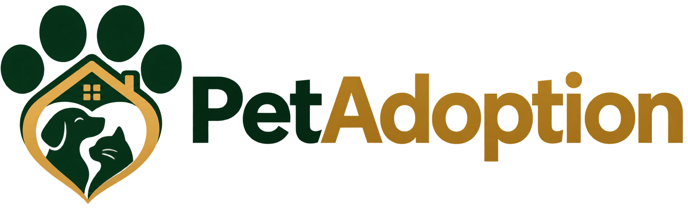
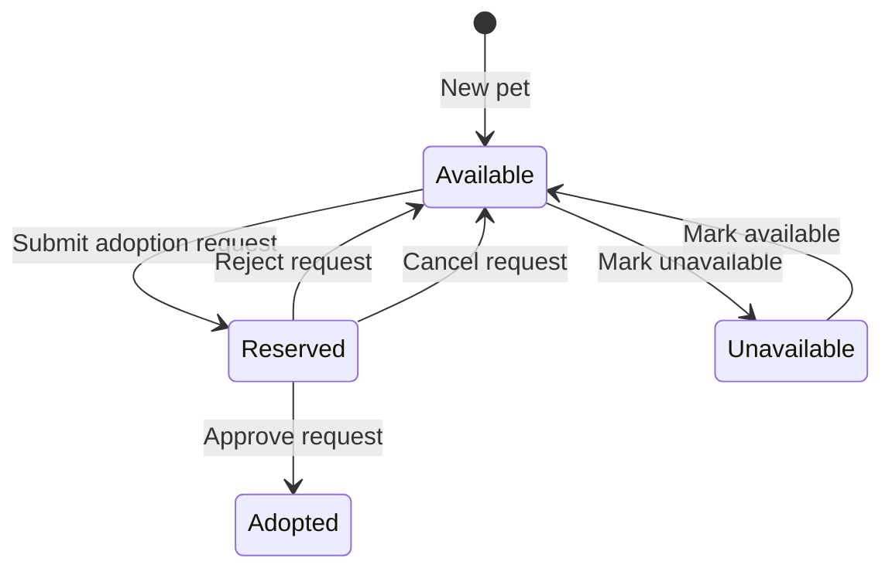
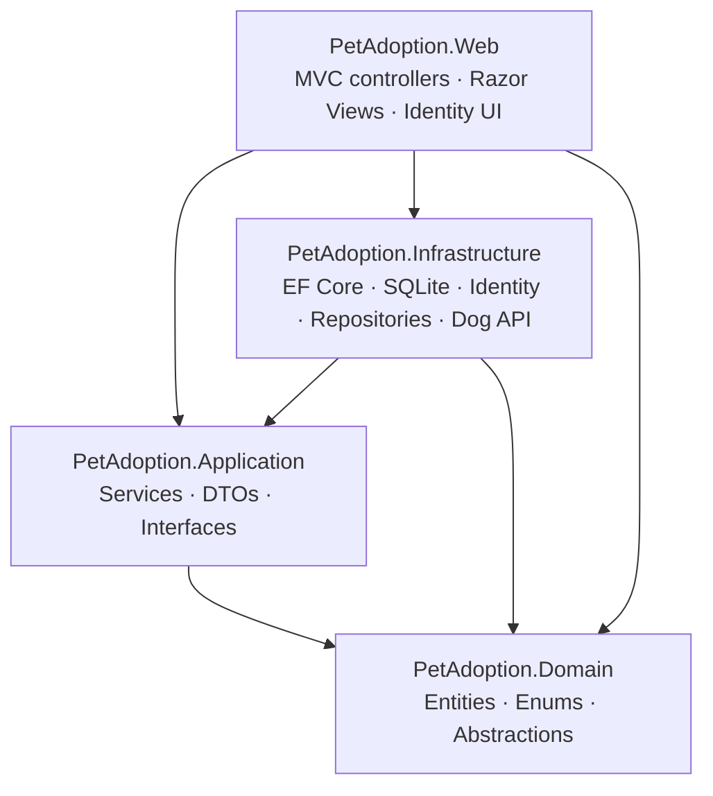

<div align="center">
  

  <h1>Pet Adoption Platform</h1>

  <p>
    An end-to-end pet adoption management application connecting adopters, animal shelters, and administrators.
  </p>

  <p>
    <a href="https://pet-adoption-platform-nuvx.onrender.com/"><strong>Explore Live Demo</strong></a>
    ·
    <a href="#getting-started"><strong>Run Locally</strong></a>
    ·
    <a href="#architecture"><strong>Architecture</strong></a>
    ·
    <a href="#testing-and-ci"><strong>Tests &amp; CI</strong></a>
  </p>

  <p>
    <a href="https://github.com/nikolasarafimov/pet-adoption-platform/actions/workflows/ci.yml"></a>
    <a href="https://pet-adoption-platform-nuvx.onrender.com/"></a>
    
    
    
  </p>
</div>

---

## At a Glance

**Pet Adoption Platform** is a full-stack web application built with **C# and ASP.NET Core MVC**. It provides a complete, role-aware workflow: shelters list animals, adopters request adoptions, and authorized staff review requests as each animal moves through the adoption lifecycle.

The solution separates business rules from persistence and presentation using a **layered Onion Architecture**. It combines **Entity Framework Core**, **SQLite**, **ASP.NET Core Identity**, server-rendered **Razor Views**, a responsive **Bootstrap 5** interface, a third-party dog-breed API, and automated tests.

| Area | Highlights |
| --- | --- |
| **Adoption workflow** | Submit, approve, reject, and cancel requests with controlled pet-status transitions |
| **Role-based access** | Adopter, Shelter, and Admin roles with server-side ownership checks |
| **Pet directory** | Search by name or breed, filter by species and status, and view detailed profiles |
| **Shelter management** | Shelter records, contact information, and restricted pet administration |
| **Breed explorer** | Dog-breed information retrieved through The Dog API |
| **Engineering** | Onion Architecture, dependency injection, EF Core migrations, unit tests, and CI |
| **Deployment** | Multi-stage Docker build with non-root runtime and configurable SQLite storage |

## Experience and Capabilities

### For adopters

- Browse pet profiles with photographs, descriptions, species, breed, age, and availability.
- Search the pet directory and narrow results using filters.
- Submit adoption requests for available pets.
- Review the status of their own requests and cancel eligible pending requests.

### For shelters

- Manage pets belonging to their own shelter.
- Create and update profiles, photos, and availability information.
- Review and process adoption requests for animals in their care.
- Access only shelter-owned resources through server-side authorization checks.

### For administrators

- Manage shelters and adopter records.
- Oversee pet records across the platform.
- Review adoption operations across shelters.
- Perform protected administrative actions without bypassing domain rules.

### Dog Breed Explorer

The application integrates with **[The Dog API](https://thedogapi.com/)** using a typed `HttpClient`. Visitors can search dog breeds and explore images, temperament, expected lifespan, and average weight. API credentials are optional for local startup and should be supplied through secure configuration when needed.

## Adoption Lifecycle

Adoption decisions are implemented in the application service layer, not solely in the user interface. Submitting a request reserves the pet; approving it completes the adoption, while rejecting or cancelling a pending request returns the pet to the available pool.



Key safeguards include:

- Requests can be submitted only for pets currently marked `Available`.
- A pet cannot have multiple active pending requests; the database also enforces this constraint.
- Only pending requests can be approved, rejected, or cancelled.
- Request cancellation is restricted to the owning adopter.
- Shelter staff can manage requests only for pets assigned to their shelter.
- `Reserved` and `Adopted` statuses are controlled through the adoption workflow rather than arbitrary profile edits.

## Architecture

The solution follows **Onion Architecture**: core domain concepts remain independent of database, web, and API implementation details.



| Project | Responsibility |
| --- | --- |
| `PetAdoption.Domain` | Business entities, enumerations, and repository abstractions |
| `PetAdoption.Application` | Use cases, service contracts, DTOs, and adoption business rules |
| `PetAdoption.Infrastructure` | EF Core persistence, SQLite, Identity storage, repositories, migrations, seeding, and external API integration |
| `PetAdoption.Web` | ASP.NET Core MVC controllers, ViewModels, Razor Views, authorization, and application startup |
| `PetAdoption.Application.Tests` | Automated unit tests for pet-management and adoption services |

### Technology Stack

| Layer | Technology |
| --- | --- |
| Language & runtime | C# · .NET 8 |
| Web framework | ASP.NET Core MVC · Razor Views |
| Frontend | Bootstrap 5 · CSS · JavaScript |
| Authentication | ASP.NET Core Identity |
| Data access | Entity Framework Core 8 · Repository Pattern |
| Database | SQLite |
| External integration | The Dog API · `HttpClient` |
| Testing | xUnit · Moq |
| CI | GitHub Actions |
| Containers & hosting | Docker · Render |

## Project Layout

```text
PetAdoptionPlatform/
├── .config/
│   └── dotnet-tools.json
├── .github/
│   └── workflows/
│       └── ci.yml
├── PetAdoption.Domain/
├── PetAdoption.Application/
├── PetAdoption.Infrastructure/
├── PetAdoption.Application.Tests/
├── PetAdoption.Web/
│   ├── Controllers/
│   ├── Models/
│   ├── Views/
│   ├── wwwroot/
│   │   └── images/
│   │       └── logo.png
│   ├── Program.cs
│   └── appsettings.json
├── Dockerfile
├── .dockerignore
├── .gitignore
├── PetAdoptionPlatform.sln
└── README.md
```

## Getting Started

### Requirements

- [.NET 8 SDK](https://dotnet.microsoft.com/download/dotnet/8.0)
- Git
- Visual Studio, JetBrains Rider, or VS Code
- Docker, if you prefer to run the containerized build

### 1. Clone and restore

```bash
git clone https://github.com/nikolasarafimov/pet-adoption-platform.git
cd pet-adoption-platform
dotnet tool restore
dotnet restore PetAdoptionPlatform.sln
```

The repository contains a local `dotnet-ef` tool manifest to keep EF Core tooling aligned with the project.

### 2. Build and test

```bash
dotnet build PetAdoptionPlatform.sln -c Release
dotnet test PetAdoptionPlatform.sln -c Release --no-build
```

### 3. Configure the optional Dog API key

The application can start without an API key. For an authenticated API configuration during local development, use .NET User Secrets:

```bash
dotnet user-secrets set "DogApi:ApiKey" "YOUR_DOG_API_KEY" --project PetAdoption.Web
```

Do not commit API keys, passwords, or production credentials to Git.

### 4. Launch the application

```bash
dotnet run --project PetAdoption.Web
```

Open the local address printed by the ASP.NET Core development server. On startup, the application applies pending Entity Framework Core migrations and, in `Development`, initializes demo data by default.

<details>
<summary><strong>Development-only demo users</strong></summary>

The local development seed provides Admin, Shelter, and Adopter accounts. Their default addresses and passwords are defined in `CreateDemoSeedCredentials` in `PetAdoption.Web/Program.cs` and can be overridden through `SeedData` configuration.

These accounts are **for local development only**. Never reuse their passwords or enable default demo credentials in a public deployment.

</details>

## Configuration

The application reads settings from `appsettings.json`, environment variables, and applicable .NET configuration providers. Its default SQLite connection uses a relative database path:

```json
{
  "ConnectionStrings": {
    "DefaultConnection": "Data Source=petadoption.db"
  },
  "DogApi": {
    "BaseUrl": "https://api.thedogapi.com"
  }
}
```

| Setting | Purpose |
| --- | --- |
| `ConnectionStrings__DefaultConnection` | Override the SQLite database path |
| `DogApi__BaseUrl` | Base URL for dog-breed requests |
| `DogApi__ApiKey` | Optional secret for The Dog API |
| `SeedData__Enabled` | Explicitly enable or disable demo seeding |
| `SeedData__AdminEmail`, `SeedData__AdminPassword` | Credentials required when enabled outside Development |
| `SeedData__ShelterEmail`, `SeedData__ShelterPassword` | Credentials required when enabled outside Development |
| `SeedData__AdopterEmail`, `SeedData__AdopterPassword` | Credentials required when enabled outside Development |

**Important:** Demo seeding is disabled by default outside `Development`. If explicitly enabled in another environment, all seed credentials must be configured securely. The database file is intentionally excluded from version control.

### Database Migrations

To inspect migration status or check for model changes:

```bash
dotnet tool run dotnet-ef migrations list --project PetAdoption.Infrastructure --startup-project PetAdoption.Web
dotnet tool run dotnet-ef migrations has-pending-model-changes --project PetAdoption.Infrastructure --startup-project PetAdoption.Web
```

The application applies pending migrations during startup. Back up an existing database before production schema changes.

## Docker

Build the production image from the repository root:

```bash
docker build -t pet-adoption-platform .
```

Create a named volume and start the container:

```bash
docker volume create petadoption-data
docker run --name petadoption --rm -p 8080:8080 -v petadoption-data:/app/data pet-adoption-platform
```

Open **http://localhost:8080**.

The multi-stage image uses the official .NET 8 runtime, runs as a non-root user, and stores its SQLite database at `/app/data/petadoption.db`. A named Docker volume keeps data independent of the container lifecycle.

The production container does **not** seed development demo accounts by default. For initial administrator setup, use a deliberate, secure account-provisioning strategy.

## Deployment

**Live demo:** [pet-adoption-platform-nuvx.onrender.com](https://pet-adoption-platform-nuvx.onrender.com/)

The application is configured for Docker-based hosting on Render and respects the host-provided `PORT` environment variable, defaulting to `8080`.

For deployments that must preserve users and adoptions across container recreation, mount persistent storage at **`/app/data`**. SQLite is a good fit for a single-instance portfolio deployment; a multi-instance deployment would need a suitable shared database solution such as PostgreSQL.

Production deployments should also provide HTTPS at the hosting edge, appropriate Data Protection key persistence, and securely managed credentials. These hosting requirements are not established by the Dockerfile alone.

## Testing and CI

The `PetAdoption.Application.Tests` project uses **xUnit** and **Moq** to exercise business logic, including:

- Pet creation, updates, deletion, and input validation
- Adoption submission and duplicate-request prevention
- Approval, rejection, and cancellation transitions
- Ownership rules and invalid operations

Run tests locally:

```bash
dotnet test PetAdoptionPlatform.sln -c Release
```

The [GitHub Actions CI workflow](https://github.com/nikolasarafimov/pet-adoption-platform/actions/workflows/ci.yml) runs on pushes and pull requests targeting `main` and executes the following sequence:

```text
Restore dependencies → Release build → Unit tests → Docker build
```

The status badge at the top of this README reflects the latest workflow result for its configured branch.

## Security and Design Decisions

- **Server-side authorization:** resource ownership and role restrictions are enforced in controllers and application logic, not just by hiding buttons.
- **Identity protections:** password complexity, unique emails, login lockout, and HTTP-only authentication cookies.
- **Request validation:** server-side model validation and automatic anti-forgery verification for unsafe MVC requests.
- **Consistent state changes:** adoption decisions use service-layer rules, with a database constraint to prevent more than one pending request per pet.
- **Secrets and local data:** development configuration and SQLite database files are excluded from Git.
- **Deployment boundaries:** persistent SQLite storage and secure initialization require explicit hosting configuration.

## Roadmap

- Email verification, password recovery, and adoption notifications
- Image uploads with durable cloud storage
- Integration tests for MVC routes, authorization, and database behavior
- Pagination and richer search for growing pet directories
- PostgreSQL support for scalable deployment
- Framework and dependency upgrades

## Author

**Nikola Sarafimov**  
[GitHub Profile](https://github.com/nikolasarafimov) · [Repository](https://github.com/nikolasarafimov/pet-adoption-platform)